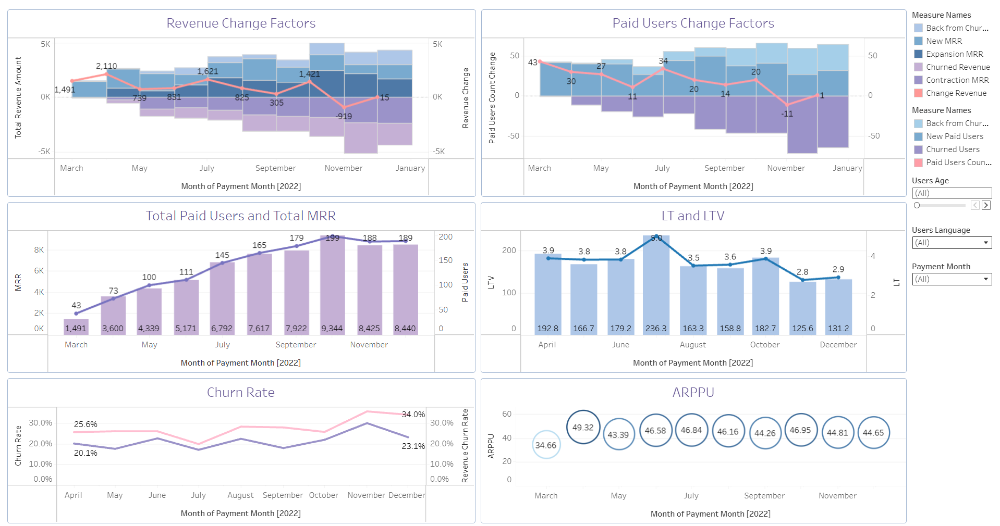

# Revenue_Metrics
 Developed an interactive dashboard to analyze subscription business performance, revenue trends, customer retention, and churn. Calculated key SaaS metrics, including MRR, ARPPU, LTV, Churn Rate, Expansion MRR, and Contraction MRR.
# My tasks:
- Data processing and preparation in SQL
- Calculating subscription metrics (MRR, ARPPU, New MRR, Churn Rate, Revenue Churn Rate)
- Analyzing customer retention, churn, and revenue dynamics
- Calculating customer lifetime metrics (Customer Lifetime, LTV)
- Developing an interactive dashboard to monitor subscription business performance
# Result:
Created an interactive subscription analytics dashboard to track revenue, customer activity, retention, and churn. Analyzed key SaaS metrics to evaluate subscription performance and identify trends in customer behavior. [Link to the dashboard](https://public.tableau.com/views/omelchuk_finalproject2/Project2RevenueMetrics?:language=en-US&:sid=&:redirect=auth&:display_count=n&:origin=viz_share_link)

